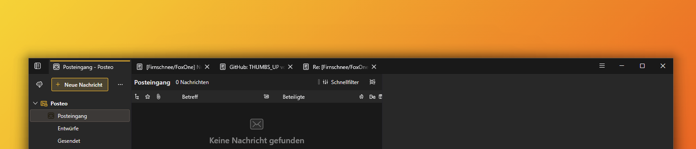

# BirdOne

One-line layout: tabs and unified toolbar share a single row, global search hidden (use CTRL+K).

> Tested on Thunderbird 159 (Supernova UI, 115+ required) on Windows.
>

BirdOne is configurable through CSS variables. See all options → [docs/customisation.md](https://firnschnee.github.io/BirdOne/customisation.html)

> The repository also contains [`userContent.css`](https://github.com/Firnschnee/BirdOne/blob/main/userContent.css) for the mail body, compose editor and settings page.
> 
> It is **work in progress** and currently not recommended: it still applies the colour layer that `userChrome.css` no longer does. BirdOne works without it.

What about Firefox?
> You are looking for [FoxOne!](https://firnschnee.github.io/FoxOne/)

*I want notifications only for selected accounts!*
> Oddly specific... but I got you covered: [NotiFilter](https://github.com/Firnschnee/NotiFilter)

---
**[Installation](https://firnschnee.github.io/BirdOne/installation.html) and [Customisation](https://firnschnee.github.io/BirdOne/customisation.html)** | Concept inspired by [@NeroWolfe75's](https://github.com/NeroWolfe75) [one-line experiment from 2023](https://www.reddit.com/r/Thunderbird/comments/15klzpr/oneliner_for_thunderbird/) | License: [MIT](LICENSE)
